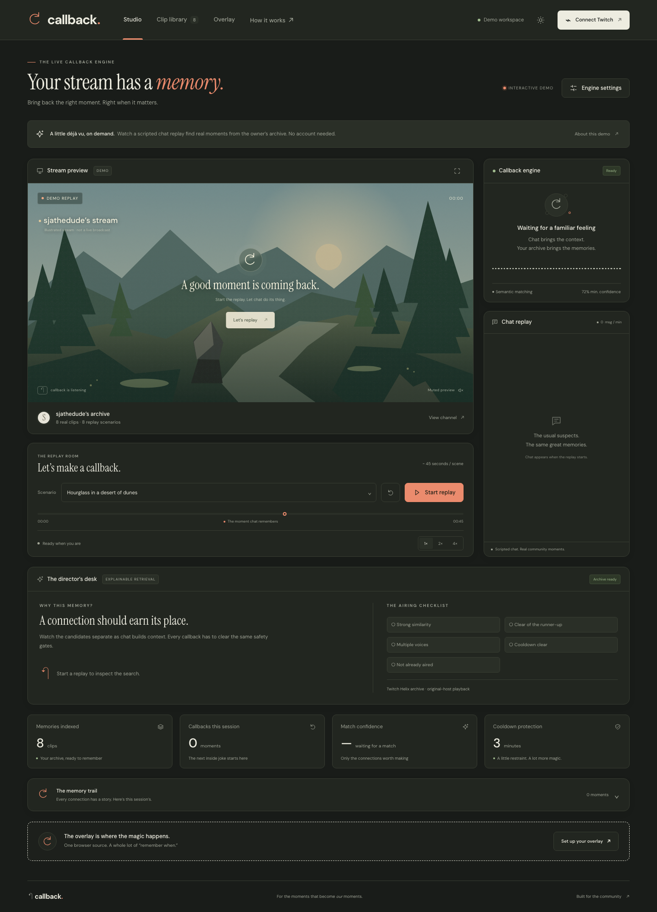
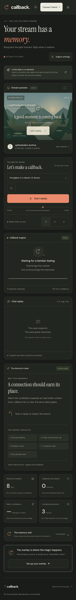

# Callback

[Live demo — callback-hackathon.sja-affu765.workers.dev](https://callback-hackathon.sja-affu765.workers.dev)

[Demo video — 2:45, 1080p](docs/callback-demo.mp4)

The edit is complete. Public YouTube upload remains a submission step. [Video script and shot list](docs/VIDEO_SCRIPT.md).

**Your stream has a memory.** Callback connects a live conversation to a streamer's past, then brings the original clip back as a live production element. It turns “remember when” into something everyone can watch together.

The demo channel is **sjathedude**, the project owner’s own channel. Eight original clips were broadcast, created through Helix, indexed, and verified. Visitors can replay correct callbacks without an account or credentials. The scripted chat matches real clip metadata; it is not historical chat.


## What works

- A metadata-driven owned-channel replay pipeline: verified broadcaster ownership, original thumbnails and dates, title-derived chat scenarios, pause, rewind, speed controls, and match evidence. All eight neural scenarios and account-free overlay delivery have passed.
- Dedicated transparent OBS page, invisible even during startup, with an animated entrance, original clip player, date, connection, progress bar, and exit.
- Server-synchronized overlays, including overlays opened on another device. Private overlay links can be rotated.
- Searchable clip library with category filters, original clip playback, and overlay previews.
- Adjustable confidence, cooldown, screen duration, automatic airing, and chat posting.
- A director’s desk with three ranked candidates, model identity, match separation, and explicit airing gates.
- Candidate reasoning, manual approval, a seven-second automatic veto window, session history restored on refresh, and downloadable evidence.
- A received-message activity graph, with no decorative activity presented as live traffic.
- Live browser-source presence and a private, downloadable OBS scene collection. Demo and live browser-source modes are separate, so rehearsals cannot accidentally appear on a live-mode source.
- Light, dark, and system themes; responsive layouts checked at 390px; keyboard focus and reduced-motion support.
- Twitch authorization-code flow, expiring state, server-only credentials, token refresh, and disconnect/revocation.
- Own-channel Helix indexing with progress, up to 500 clips per index operation, category resolution, neural embeddings, and durable vector storage.
- Authenticated EventSub chat, rolling context, three distinct voices, confidence and ambiguity gates, duplicate suppression, and server-enforced cooldowns.
- Optional chat link posting after a live callback, with explicit confirmation only when Twitch reports `is_sent`. Twitch 429 responses stop further requests until the reset window.

**Production Twitch app configured:** the app credentials are stored as Cloudflare secrets. Twitch accepted the credentials, an authenticated Helix metadata request succeeded, and the production authorization route uses the expected callback. The owner confirmed successful broadcaster authorization. Own-channel indexing, real EventSub receipt, semantic retrieval, veto cancellation, confirmed chat posting, and native OBS playback were verified against the owner’s channel. The recorded live takes use explicitly labeled owner rehearsal. Channel-event triggers such as raids and subscriptions are not included.

## Run from a clean clone

Requires **Node.js 22 or newer**. The included `.nvmrc` selects Node 22 if you use nvm.

```sh
git clone https://github.com/sja-thedude/callback-hackathon.git
cd callback-hackathon
npm ci
npm run dev
```

Open **http://localhost:8787**. Wrangler may request Cloudflare authentication for the remote embedding binding. The replay attempts server-side neural retrieval and uses an explicitly labeled local fallback if that service is unavailable. The deployed replay contains the eight real owned clips.

```sh
npm test
npm run check
npx playwright install chromium
npm run test:browser
```

The browser suite verifies replay, real-time overlay synchronization, transparent rendering, search, filters, saved settings, all screens in both themes at desktop and phone sizes, and the configured or unconfigured connection state. `TEST_URL` selects a deployed target instead of localhost. Tests write screenshots to `docs/screenshots/`.

## Connect a live channel

1. Register a Twitch developer application at https://dev.twitch.tv/console/apps. Register this exact OAuth redirect URL: **https://callback-hackathon.sja-affu765.workers.dev/auth/callback**. For local testing also register **http://localhost:8787/auth/callback**.
2. Configure the two server secret names below using `wrangler secret put`. For local development, copy `.env.example` to `.dev.vars` and populate it privately.
3. Connect Twitch in the studio, select **Index my clips**, and wait for the progress indicator to complete.
4. Start listening. Automatic airing defaults off. Review candidates and approve the strong connections, or enable automatic callbacks after tuning the threshold.
5. In the Overlay tab, copy the private browser source into OBS. Set **1920 × 1080**. Keep the studio open while streaming.

Environment variable names only:

- `TWITCH_CLIENT_ID`
- `TWITCH_CLIENT_SECRET`

Requested Twitch scopes: `user:read:chat` and `user:write:chat`. The connected broadcaster is the chat sender. No access or refresh token is returned to the browser.

## How retrieval works

Live indexing embeds each clip's title and game category with **BGE Small English v1.5** through the Cloudflare embedding binding. Vectors live in the streamer's own Durable Object in bounded storage records. Every five seconds at most, the engine embeds a rolling 30-second chat window and ranks clips by cosine similarity.

A callback must exceed the configured score, beat the runner-up by at least 0.08, clear the cooldown, and not have aired or been vetoed in this session. Three distinct chatters are required. Manual approval cannot bypass these checks, and candidates expire after 45 seconds. Automatic matches wait seven seconds for a veto, then recheck confidence, ambiguity, cooldown, duplicate status, freshness, and chat voices before airing. Similarity is a retrieval signal, not a calibrated probability.

The account-free demo runs **BGE Small English v1.5** retrieval over an API-verified, fixed public library. Its neural endpoint accepts only known replay windows; it cannot accept arbitrary inference prompts. Public vectors and replay search results are cached, concurrent identical requests share work, and an edge rate limiter bounds inference requests. A labeled local concept-assisted vector fallback keeps rehearsal usable if neural retrieval is temporarily unavailable. Similarity remains a retrieval signal rather than a calibrated probability.

Replay text is generated from actual indexed clip titles, not presented as historical chat or a clip transcript. Demo cooldown is compressed to eight seconds; connected live cooldowns have a one-minute minimum. Live retrieval uses clip metadata rather than VOD transcripts; vague titles may not produce a strong match.

Refresh the public demo snapshot with `npm run index:demo -- --channel sjathedude --owned-content` using Node 22+ and credentials in the ignored `.env` file. The script retrieves up to 500 clips through Helix, selects the newest eight, verifies each broadcaster ID, resolves categories, and writes only public metadata to `public/demo-library.js`. It also creates title-based recording phrases in `docs/TRIGGER_PHRASES.md`. An empty channel stops the command without replacing the index; `--publish-empty` explicitly removes the old archive and publishes the honest waiting state. Live and public indexing share metadata normalization and embedding input formatting.

## Stack and architecture

- Vanilla JavaScript modules and CSS. No frontend runtime dependencies.
- Cloudflare Worker for OAuth, Helix access, security boundaries, and static assets.
- One Durable Object per private studio for settings, tokens, vectors, callback history, and WebSocket fan-out.
- Cloudflare's BGE embedding binding for connected live channels.
- Twitch Helix, EventSub WebSockets, original-host clip embeds, and authorized audio-free MP4 copies of the eight owned demo clips.
- DM Sans and Instrument Serif, with system fallbacks. All illustrated app artwork is original SVG.

The browser owns the authenticated EventSub socket; its opaque session ID is sent to the server to create a subscription. Received text is batched back to the private studio, where retrieval and airing rules run. The OBS source receives callback events through a read-only, key-protected WebSocket. Closing the studio stops live chat ingestion; the overlay alone does not ingest chat.

## Deploy

```sh
npx wrangler login
npx wrangler secret put TWITCH_CLIENT_ID
npx wrangler secret put TWITCH_CLIENT_SECRET
npm run deploy
```

`wrangler.jsonc` names the Worker **callback-hackathon**, binds its Durable Object namespace and embedding service, and serves `public/`. Its account ID identifies this deployment; use your own Cloudflare account ID when deploying a fork. Cloudflare's runtime services may incur normal usage charges. No managed vector database is needed.

Static response headers restrict script, frame, and asset origins. Mutating requests and studio WebSockets require a matching origin. Cookies are HttpOnly, Secure in production, and SameSite=Lax. Overlay links are read-only bearer secrets, separate from the HttpOnly controller credential; resetting a link closes existing sockets. Disconnect revokes the Twitch token and clears the session's channel data. Changing broadcasters clears the old archive, disables automatic airing/chat posting, and revokes old overlay links. A final ownership gate also rejects foreign or unindexed clips at the moment of airing.

## Demo content and playback

The demo is restricted to **[sjathedude](https://www.twitch.tv/sjathedude)**, the project owner’s channel, verified through Helix as broadcaster `1599601409`. The eight original scene clips were broadcast to the owner’s channel and created through Helix for the public replay and submission video. No third-party channel archive is included. Empty channel data is not replaced with fictional media. Original thumbnails, dates, categories, and durations come from the real index. Categories absent from Helix are labeled Uncategorized.

Twitch player policies, deleted clips, or browser autoplay rules can affect playback. Every indexed callback retains its original clip link. The app’s landscape is an original preview backdrop, not a clip thumbnail. The OBS source is transparent outside callbacks.

## Automated broadcast and capture

The [automation guide](docs/AUTOMATED_CAPTURE.md) covers original scene rendering, a real RTMP broadcast, eight explicitly titled Helix clips, owned media preparation, and Puppeteer product recordings. The owner provided the private stream key and authorized optional capture permissions. The build segment presents selected original session-export evidence with explicit provenance. Ordinary sign-in keeps its chat-only permissions. Credentials are not exported into the video or public assets. The workflow completed against the live broadcaster, including eight clips and two genuine chat-triggered callbacks.

## Live verification and video

Follow the [step-by-step live walkthrough](docs/LIVE_WALKTHROUGH.md). Live chat uses authenticated EventSub WebSockets; there is no separate IRC connection. Keep the studio open while streaming. Community mode requires three actual chatters. An explicitly labeled owner-rehearsal mode accepts only the broadcaster’s own messages for an automated live test; the other airing gates still apply.

The [video script](docs/VIDEO_SCRIPT.md) follows a 2:45 shot list. Kokoro `af_heart` narration and 23 timed caption cues have been generated locally. The earlier third-party-clip recordings were removed from the current submission assets. The product takes and authentic exported build evidence are recorded. Public YouTube upload remains an external submission step. Video tooling is described in [the production guide](docs/VIDEO_PRODUCTION.md).

The [submission copy](docs/SUBMISSION.md), [requirements checklist](docs/HACKATHON_REQUIREMENTS.md), and [verification record](docs/VERIFICATION.md) record verified behavior and the remaining publication steps.

## Screenshots





## Checks

`npm test` covers retrieval and server safety. `npm run check` checks module syntax. `npm run test:cold` opens fresh browser contexts at 390px and 1440px in both themes. `npm run test:production` requires real owned clips and fails while the archive is empty, so a waiting page cannot be reported as a complete replay test.

`npm run check:secrets` checks the exact configured local Twitch values against branch/remote/tag history, tracked files, and the index without printing their values. Gitleaks supplements this with generic secret detection. Ignored environment files are never committed.

Actual OBS Studio 33.0.1 has been tested with a 1920 × 1080 browser source. The updated idle source was captured in real OBS and every alpha value was zero. A real owner-rehearsal callback was visible with alpha extrema [0, 255], and its exit returned to [0, 0]; see [the OBS verification record](docs/OBS_VERIFICATION.md).

## Project workflow

Feature work is committed on named feature branches, integrated into `dev`, then promoted to `main` after checks and submission readiness. Commits use the repository owner's configured name and email. The MIT license was included in the first implementation commit.

MIT License. See [LICENSE](LICENSE).
