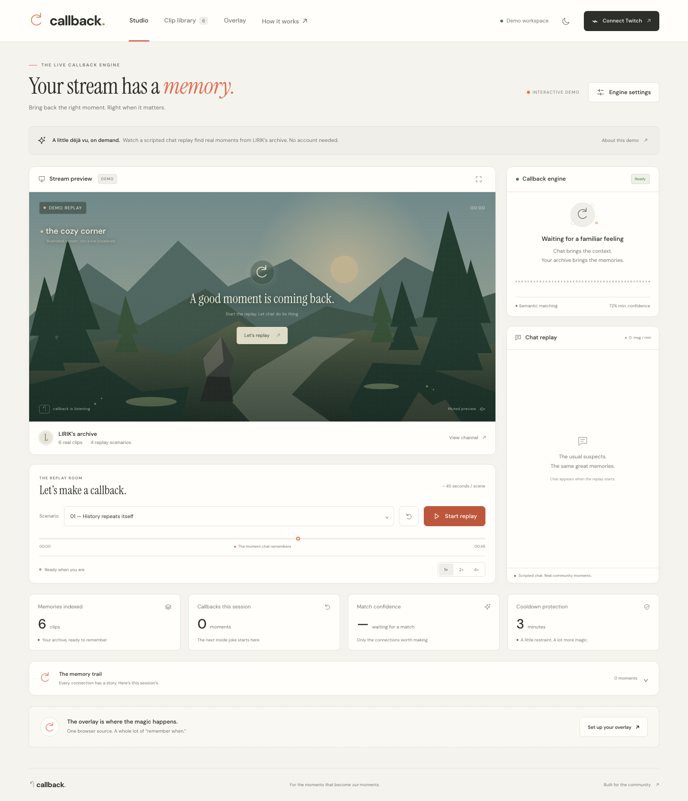
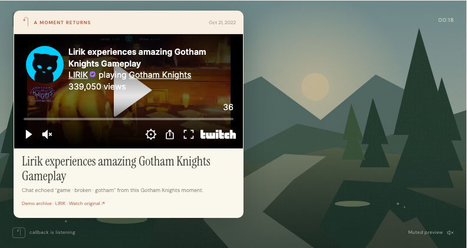

# Callback

[Live demo — callback-hackathon.sja-affu765.workers.dev](https://callback-hackathon.sja-affu765.workers.dev)

**Your stream has a memory.** Callback connects a live conversation to a streamer's past, then brings the original clip back as a live production element. It turns “remember when” into something everyone can watch together.

Open the demo, press **Let’s replay**, and watch the engine find a connection. No account, credentials, or setup required.



## What works

- Four scripted replay scenarios against six real, credited public clips. Pause, rewind, change speed, and inspect the result.
- Transparent OBS browser source with an animated entrance, original clip player, date, connection, progress bar, and exit.
- Server-synchronized overlays, including overlays opened on another device. Private overlay links can be rotated.
- Searchable clip library with category filters, original clip playback, and overlay previews.
- Adjustable confidence, cooldown, screen duration, automatic airing, and chat posting.
- Candidate reasoning, manual approval, veto, session history, and downloadable evidence.
- Light, dark, and system themes; responsive layouts checked at 390px; keyboard focus and reduced-motion support.
- Twitch authorization-code flow, expiring state, server-only credentials, token refresh, and disconnect/revocation.
- Own-channel Helix indexing with progress, up to 500 clips per index operation, category resolution, neural embeddings, and durable vector storage.
- Authenticated EventSub chat, rolling context, three distinct voices, confidence and ambiguity gates, duplicate suppression, and server-enforced cooldowns.
- Optional chat link posting after a live callback. Twitch 429 responses stop further requests until the reset window.

**Live Twitch setup is required:** the deployment does not include a Twitch application's credentials. OAuth, indexing, EventSub, and chat posting are implemented and covered by component tests, but require a registered Twitch app and a real broadcaster connection for end-to-end verification. Channel-event triggers such as raids and subscriptions are not included.

## Run from a clean clone

Requires **Node.js 22 or newer**. The included `.nvmrc` selects Node 22.

```sh
git clone https://github.com/sja-thedude/callback-hackathon.git
cd callback-hackathon
nvm use
npm ci
npm run dev
```

Open **http://localhost:8787**. Wrangler may request Cloudflare authentication for the remote embedding binding. The local demo performs retrieval in the browser and does not call that binding.

```sh
npm test
npm run check
npx playwright install chromium
npm run test:browser
```

The browser suite verifies replay, real-time overlay synchronization, transparent rendering, search, filters, saved settings, all screens in both themes at desktop and phone sizes, and the unconfigured connection state. `TEST_URL` selects a deployed target instead of localhost. Tests write screenshots to `docs/screenshots/`.

## Connect a live channel

1. Register a Twitch developer application at https://dev.twitch.tv/console/apps. Register this exact OAuth redirect URL: **https://callback-hackathon.sja-affu765.workers.dev/auth/callback**. For local testing also register **http://localhost:8787/auth/callback**.
2. Configure the two server secret names below using `wrangler secret put`. For local development, copy `.env.example` to `.dev.vars` and populate it privately.
3. Connect Twitch in the studio, select **Index my clips**, and wait for the progress indicator to complete.
4. Start listening. Automatic airing defaults off. Review candidates and approve the strong connections, or enable automatic callbacks after tuning the threshold.
5. In the Overlay tab, copy the private browser source into OBS. Set **1920 × 1080**. Keep the studio open while streaming.

Environment variable names only:

- `TWITCH_CLIENT_ID`
- `TWITCH_CLIENT_SECRET`

Requested Twitch scopes: `user:read:chat` and `user:write:chat`. The connected broadcaster is the chat sender. No access or refresh token is returned to the browser.

## How retrieval works

Live indexing embeds each clip's title and game category with **BGE Small English v1.5** through the Cloudflare embedding binding. Vectors live in the streamer's own Durable Object in bounded storage records. Every five seconds at most, the engine embeds a rolling 30-second chat window and ranks clips by cosine similarity.

A callback must exceed the configured score, beat the runner-up by at least 0.08, clear the cooldown, and not have aired or been vetoed in this session. Three distinct chatters are required. Manual approval cannot bypass these checks, and candidates expire after 45 seconds. Similarity is a retrieval signal, not a calibrated probability.

The account-free demo uses a deterministic, concept-assisted 256-dimensional vector index and manually written replay context. It demonstrates retrieval and timing without making neural inference calls. Demo cooldown is compressed to eight seconds; connected live cooldowns have a one-minute minimum. Chat replay, contextual tags, and illustrated scenery are authored demo material, not historical chat or gameplay footage. Live retrieval uses clip metadata rather than VOD transcripts; short or vague titles may not produce a strong match.

## Stack and architecture

- Vanilla JavaScript modules and CSS. No frontend runtime dependencies.
- Cloudflare Worker for OAuth, Helix access, security boundaries, and static assets.
- One Durable Object per private studio for settings, tokens, vectors, callback history, and WebSocket fan-out.
- Cloudflare's BGE embedding binding for connected live channels.
- Twitch Helix, EventSub WebSockets, and the original-host clip embed.
- DM Sans and Instrument Serif, with system fallbacks. All illustrated app artwork is original SVG.

The browser owns the authenticated EventSub socket; its opaque session ID is sent to the server to create a subscription. Received text is batched back to the private studio, where retrieval and airing rules run. The OBS source receives callback events through a read-only, key-protected WebSocket. Closing the studio stops live chat ingestion; the overlay alone does not ingest chat.

## Deploy

```sh
npx wrangler login
npx wrangler secret put TWITCH_CLIENT_ID
npx wrangler secret put TWITCH_CLIENT_SECRET
npm run deploy
```

`wrangler.jsonc` names the Worker **callback-hackathon**, binds its Durable Object namespace and embedding service, and serves `public/`. Its account ID identifies this deployment; use your own Cloudflare account ID when deploying a fork. Cloudflare's runtime services may incur normal usage charges. No managed vector database is needed.

Static response headers restrict script, frame, and asset origins. Mutating requests and studio WebSockets require a matching origin. Cookies are HttpOnly, Secure in production, and SameSite=Lax. Overlay links are bearer secrets; resetting a link closes existing sockets. Disconnect revokes the Twitch token and clears the session's channel data.

## Demo credit and playback

The demo archive credits **[LIRIK](https://www.twitch.tv/lirik)**. Six public clip references were checked against [the public clip listing](https://www.twitchmetrics.net/c/23161357-lirik/clips). Titles, game categories, dates, and view counts are curated metadata snapshots; counts will change. Original clips remain on Twitch and belong to their creators. They are embedded, never copied or redistributed. The public demo archive is isolated from connected channels and never enters their live retrieval index.

Autoplay, cookies, geographic restrictions, deleted clips, or host policy can affect embedded playback. Every callback includes a direct original clip link. Clip illustrations are labeled and do not stand in for claimed gameplay. For OBS, the source has a true transparent background and shows nothing between callbacks.

## Screenshots




## Project workflow

Feature work is committed on `feature/callback-engine`, integrated into `dev`, then promoted to `main` after checks. Commits use the repository owner's configured name and email. The MIT license was included in the first implementation commit.

MIT License. See [LICENSE](LICENSE).
